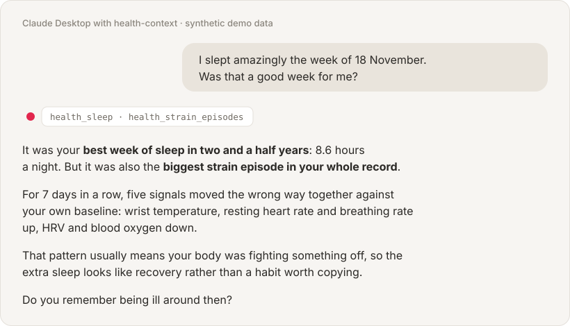

# health-context

**Ask Claude about your Apple Health data, and get answers that know what is normal for *you*.**

[](https://github.com/benasja/health-context/actions/workflows/ci.yml)
[](https://github.com/benasja/health-context/releases/latest)
[](LICENSE)

<p align="center">
  
</p>

Your iPhone and Apple Watch have been recording your sleep, heart rate, HRV,
workouts and steps for years. health-context lets Claude read all of it and
compare today with your own history, not with population averages. "Your HRV is
50 ms" doesn't tell you anything. "Your HRV is in the top fifth of your own
record" does.

- **Runs on your computer.** Your export is read on your computer and never
  uploaded. Claude only sees the short answers to the questions it asks.
- **No account, no subscription, no Terminal.** Install it in Claude Desktop
  in a few clicks.
- **Free and open source** (MIT).

## Get started

You need a Mac or Windows PC with [Claude Desktop](https://claude.ai/download),
and an iPhone.

**1. Install the extension.** Download
[**health-context.mcpb**](https://github.com/benasja/health-context/releases/latest/download/health-context.mcpb)
and double-click it. Claude Desktop opens and asks to install it. Click
**Install**. When it asks where your export will be, leave it on **Downloads**.

**2. Export your health data.** On your iPhone, open the **Health** app, tap your
profile picture (top right), then **Export All Health Data**. It takes a few
minutes, then shows a share sheet:

- **Mac:** AirDrop it to your Mac. It lands in Downloads.
- **Windows:** save it to iCloud Drive or email it to yourself, then put the zip
  in your Downloads folder.

Leave it zipped.

**3. Ask Claude.** Start a new chat and ask anything:

> How did I sleep last month compared with my best month?
>
> Am I fitter than a year ago?
>
> What were my ten biggest training days ever?
>
> Was I ill in November? What do my vitals say?
>
> Which of my habits actually move my HRV?

The first time takes a minute or two while it reads the export. Claude will say
so if you ask too early. On a Mac, Claude Desktop may ask to access your
Downloads folder: allow it.

**Keeping it up to date:** export again whenever you like (once a month is
plenty) and send it to Downloads the same way. The newest export is picked up
by itself, with no restart.

## Tell it what the data can't know

Your watch records what your body did, never why. If your training dropped
because of surgery, an assistant that doesn't know will tell you to get your
motivation back. So tell Claude once:

> Remember that I had wrist surgery in November 2025, and that I'm training
> for a half marathon in April.

It saves this to a short profile on your computer (`health_profile_update`) and
reads it first in every later chat. You can ask it to show or change the profile
at any time.

## Why the answers are better than pasting numbers into a chat

Ask an assistant about raw health numbers and it can only describe the last few
weeks. health-context first works out your personal baselines, percentiles and
best periods across your whole history, plus which days you weren't wearing the
watch and which records were counted twice. Then it hands Claude the finished
comparison.

The picture at the top is a real example from the synthetic demo data. In the
week of 18 November 2024, the demo person had the best week of sleep in two and a
half years. Hand an assistant the raw rows and it will congratulate them. But
five vital signs moved the wrong way together that week (wrist temperature,
resting heart rate, HRV, breathing rate and blood oxygen), which is what illness
looks like. Only something that knows that person's normal can tell resting
apart from recovering.

Nothing about that week is hardcoded. The strain detector found it on its own,
and every baseline was inferred from the export. More on the method:
[docs/how-it-works.md](docs/how-it-works.md).

## Privacy

- The export is read on your computer. This project makes no network calls and
  sends your data nowhere. (When you install the extension, Claude Desktop
  downloads a private copy of Python once, to run it.)
- Claude gets only what a question needs, such as a table of weekly sleep
  averages, through the chat you are already having. Your chats are handled the
  way Anthropic handles any Claude conversation.
- Want nothing to leave your computer at all? It also works with local models:
  see [docs/mcp.md](docs/mcp.md#other-clients-and-local-models).
- What it builds is kept in `~/Library/Application Support/health-context` on a
  Mac (`%APPDATA%\health-context` on Windows). That is outside Documents and
  Desktop, which may be syncing to iCloud. Delete the folder to remove
  everything.
- No health data is ever committed to this repository, and CI fails if any is.

## Not medical advice

Every baseline here is yours, not a population norm, and every flag is a prompt
to pay attention, not a diagnosis. If something concerns you, talk to a
clinician.

---

## For technical users

Everything above is the same Python code you can run yourself. Python 3.10+,
**standard library only**, on macOS, Linux and Windows.

| You want to | Read |
|---|---|
| Convert an export into CSVs and a written report, or try the synthetic demo | [docs/command-line.md](docs/command-line.md) |
| Use it from Claude Code, Cursor, another MCP client, or a local model | [docs/mcp.md](docs/mcp.md) |
| Keep it current automatically from your phone, through a home server | [docs/health-bridge.md](docs/health-bridge.md) |
| Know what it computes and why (baselines, wear detection, de-duplication, sleep, scores) | [docs/how-it-works.md](docs/how-it-works.md) |

The quickest look, with no export of your own:

```bash
git clone https://github.com/benasja/health-context && cd health-context
python3 fixtures/make_demo_export.py --out-dir demo
python3 convert_health_data.py --data-dir demo --out-dir demo
python3 health_mcp.py --data-dir demo --check
```

### What Claude can look up

`health_mcp.py` is an [MCP](https://modelcontextprotocol.io) server
exposing 22 tools over stdio. The extension runs it with `--export ~/Downloads`,
which builds the data in the background and picks up newer exports
([health_watch.py](health_watch.py)).

<details>
<summary>All 22 tools</summary>

| Tool | Answers |
|------|---------|
| `health_overview` | Where things stand now vs what you have sustained before |
| `health_list_metrics` | What is available and how completely it is covered |
| `health_metric_stats` | Summary of one metric, and where it sits in your history |
| `health_compare_periods` | Two date ranges, head to head |
| `health_top_days` | Best or worst days, dated |
| `health_day_detail` | Everything about one specific day |
| `health_sleep` | Duration, stages, efficiency, timing |
| `health_workouts` | Sessions, or totals by activity type |
| `health_workout_detail` | One workout minute by minute: HR drift at steady power, recovery after the hardest minute |
| `health_hr_timeline` | Heart rate and steps through a day or night in 5-minute buckets, each labelled with its sleep stage, workout, or walking, light activity or stationary — for graphing |
| `health_strength_sessions` | Strength workouts logged in Wariden: program, sets, reps, volume, weight x reps per exercise |
| `health_strength_session` | One strength workout set by set: weight, reps, RPE, estimated 1RM, notes |
| `health_strength_progress` | One exercise across sessions (top set, best estimated 1RM), or every exercise logged |
| `health_strain_episodes` | Multi-signal physiological flags, grouped |
| `health_weekly` | Week-by-week rollup |
| `health_context_pack` | The whole briefing |
| `health_profile` | Your goals and constraints, if you wrote any down |
| `health_profile_update` | Save what you told it about yourself, for every later chat |
| `health_data_quality` | Wear rates, coverage, excluded artifacts |
| `health_recommend` | Record a suggestion, the evidence for it and the metrics that should move |
| `health_recommendations` | Earlier suggestions, whether they were followed, and what the data did since |
| `health_recommendation_update` | Whether a suggestion is being followed, with a note |

</details>

Four of them write anything: `health_profile_update`, and the three suggestion
tools. A chat's advice usually ends with the chat: "lights out by 23:30" is
given, maybe followed, and never checked. `health_recommend` keeps it with its
evidence and the metrics that should move, and `health_recommendations` later
compares the days since with the four weeks before. It calls a change better or
worse only when it is larger than the day-to-day noise, and it says that it
can't tell what caused it.

Every answer starts with a line saying how fresh the data is, and whether
today's totals are still partial.

### Building the extension

```bash
python3 extension/build.py      # -> dist/health-context.mcpb
```

It reads the version from `pyproject.toml` and the tool list from the server, so
the manifest can't drift. Releases attach the built file.

### Development

```bash
python3 test_health.py                  # stdlib only
pip install ruff && ruff check .
```

Every test corresponds to a bug that actually shipped and produced a plausible
*wrong number* rather than an error: percent metrics reported as fractions,
sleep nights split across calendar days, an isolated sensor artifact setting max
HR for a whole history, basal energy marking unworn days as worn. A pipeline
that crashes tells you it is broken. One that emits confident nonsense does not.

CI runs the tests on Python 3.10–3.13, macOS and Windows, executes the fixtures
end to end, and fails the build if any health-data file is ever tracked by git.

### Limitations

**Validated against one person's export.** Every fix so far came from a single
~2M-record dataset from an Apple Watch, an iPhone and a Wahoo trainer. Other
devices, apps and locales will exercise paths that have never run.
[Bug reports](https://github.com/benasja/health-context/issues) describing the
shape of your data are genuinely useful.

**Scores are judgement, not instruments.** The recovery weights, the load-band
thresholds and the sleep-session gap are all documented where they are defined,
and none was derived from research on you. Component breakdowns are always shown,
so a number can be checked rather than trusted.
